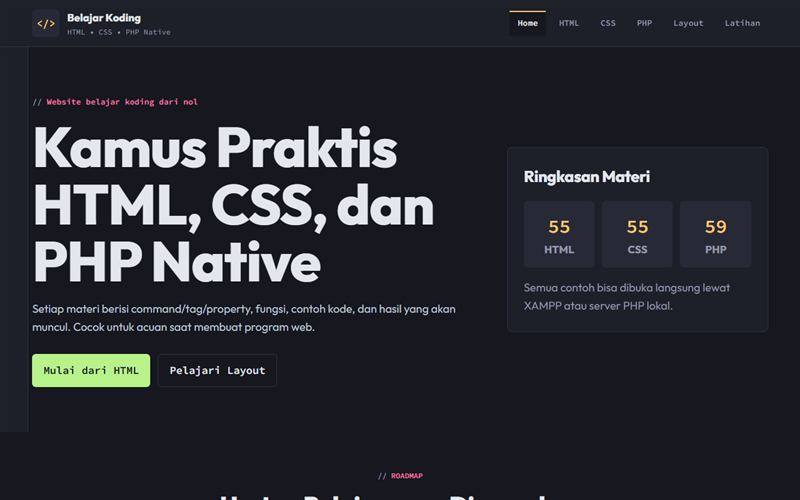

# Belajar Koding

Kamus praktis HTML, CSS, dan PHP Native.

**Demo:** https://portofolio-jauza-fawaid.netlify.app/BELAJAR-KODING/



Website ini dibuat untuk belajar:

- HTML
- CSS
- PHP Native
- Tata letak/layout website
- Form sederhana dengan PHP

## Struktur Folder

```text
BELAJAR-KODING/
├── index.php
├── belajar-html.php
├── belajar-css.php
├── belajar-php.php
├── belajar-layout.php
├── latihan.php
├── assets/
│   └── css/
│       └── style.css
├── data/
│   └── materi.json
└── includes/
    ├── functions.php
    ├── header.php
    └── footer.php
```

## Cara Menjalankan dengan XAMPP

1. Extract folder ini.
2. Letakkan folder `BELAJAR-KODING` ke:

```text
C:\xampp\htdocs\
```

3. Jalankan Apache di XAMPP.
4. Buka browser:

```text
http://localhost/BELAJAR-KODING/index.php
```

## Cara Menjalankan dengan PHP Built-in Server

Buka terminal di dalam folder ini:

```bash
cd C:\xampp\htdocs\BELAJAR-KODING
php -S localhost:8000
```

Lalu buka:

```text
http://localhost:8000/index.php
```

## Isi Website

- `index.php`  
  Halaman utama dan roadmap belajar.

- `belajar-html.php`  
  Kamus tag HTML: fungsi, contoh kode, dan hasil yang muncul.

- `belajar-css.php`  
  Kamus CSS: selector/property, fungsi, contoh kode, dan demo visual.

- `belajar-php.php`  
  Kamus PHP Native: command, fungsi, contoh kode, output, dan form yang benar-benar diproses PHP.

- `belajar-layout.php`  
  Panduan tata letak: div, section, flexbox, grid, sidebar, card, dan form layout.

- `latihan.php`  
  Checklist latihan dan mini form PHP.

## Catatan

Materi ini sangat lengkap untuk dasar sampai menengah awal, tetapi dunia HTML/CSS/PHP sangat luas. Kamu bisa menambahkan materi baru dengan mengedit file:

```text
data/materi.json
```
# website_belajar_koding_sederhana
